  
  
  

---

## About Me

  

 

I build web products **end-to-end** — API design and business logic on the backend, modern and friendly interfaces on the frontend. I believe good software isn't just code that runs: it has to **run fast, stay maintainable, and deliver real value to the end user**.

---

## Featured Projects

> 🔒 **Note:** These projects are owned by companies/partners and kept in private repositories. Only the technical approach and my role are described — no confidential details.

  

&nbsp;<b>▸ Read more — role &amp; technical details</b>

 

**Role:** Fullstack Developer — owned the entire frontend (Next.js), built the backend APIs (Node.js), integrated the AI Agent, and developed the realtime layer.

- **Realtime system** — staff dashboard with queue management, connection-state handling via SignalR, multi-tier notifications (Desktop / Audio / Visual)
- **AI Agent integration** — multilingual AI assistant (RAG), multimodal image processing, invoice data extraction, automated Telegram/Email notifications
- **Performance** — modern Bento UI, image optimization + caching, PageSpeed > 90 on all devices

**Stack:** `Next.js` · `React` · `Node.js` · `SignalR` · `AI RAG` · `MongoDB` · `Redis` · `Docker`

 

  

&nbsp;<b>▸ Read more — role &amp; technical details</b>

 

**Role:** Designed & built everything — from UI concept to production deployment on Vercel.

- **Bento Grid layout** — responsive grid that adapts to every screen size
- **Core Web Vitals** — Lighthouse 95–100, LCP < 0.8s via Static Site Generation
- **Micro-interactions** — spotlight effects, fluid motion with Framer Motion
- **i18n** — instant EN ⇄ VI switching, no page reload

**Stack:** `Next.js` · `React` · `TypeScript` · `Tailwind CSS` · `Framer Motion`

🔗 **Live:** [nguyenminhhuy-portfolio.vercel.app](https://nguyenminhhuy-portfolio.vercel.app/)

---

## Tech Stack

  

---

## How I Work

  

---

## GitHub Activity

---

