  

**[Portfolio](https://nguyenminhhuy-portfolio.vercel.app/)** &nbsp;·&nbsp; **[Email](mailto:nguyenminhhuy01234@gmail.com)** &nbsp;·&nbsp; Ho Chi Minh City, VN &nbsp;·&nbsp; Open to the right projects

I work across the stack: .NET and Node on the backend, Next.js and TypeScript on the front. The part I like most is where the two meet — data flow, latency, and the things that have to hold up once real people are using them.

I currently work in R&D at a software company, mostly wiring AI into products that are already running: SignalR for chat, Semantic Kernel and a vector database for RAG assistants. Most of that work is under NDA, so what follows is the part I am free to share.

## Selected work

  

I built the real-time chat flow on SignalR and its interface for an F&B brand's Japanese food ordering site, then wired a RAG assistant into that window. The assistant classifies customer intent, answers from the menu data and hands off to a human when a question falls outside its scope. The rest of the site was handled by others on the team.

- **One chat window, two kinds of responder.** Bot and staff share a single SignalR connection, and the conversation does not break at handover.
- **Routing by intent.** A fast classifier sorts questions into products, restaurant info, promotions or orders; low confidence escalates to a human.
- **Answers that come with the dish.** RAG pulls context from the menu data and returns clickable product cards, so an order can start inside the chat.

`Next.js` `React` `.NET` `SignalR` `MongoDB` `Redis` `Docker` &nbsp;·&nbsp; [unagi.vn](https://unagi.vn)

 

  

A two-stage pipeline: StarCoderBase-1B, fine-tuned with LoRA, turns a user story into Given–When–Then Gherkin scenarios; Qwen2.5-Coder-1.5B then takes that scenario together with the page's HTML and generates runnable Cypress code. Both models are self-hosted. I did the training, the evaluation and the web app, in a three-person thesis at Ho Chi Minh City University of Industry and Trade (December 2025).

- **Fine-tuning a small model instead of calling a large one.** LoRA injects small low-rank matrices into selected layers, so training was feasible on limited hardware and business data never leaves the system.
- **From scenario to runnable Cypress code.** The second stage receives the Gherkin alongside the page's HTML DOM, so selectors in the generated code follow the real structure rather than being guessed.
- **Models loaded on demand.** The two models never sit in memory together — each stage loads its own, which is what makes the whole thing fit the available hardware.

**Results.** 3,412 scenarios from 100 requirements, 3,345 of them structurally complete (about 98%), split into 2,015 happy-path and 1,397 negative-path. An independent review by a QC lead found syntax and semantics accurate, but coverage not yet deep enough for specialised cases; roughly 2% of scenarios were cut short by the token limit.

`Python` `StarCoderBase-1B` `Qwen2.5-Coder-1.5B` `LoRA / PEFT` `Gherkin / BDD` `Cypress` `Node.js`

 

  

My personal site: Next.js App Router, scroll animation driven by GSAP ScrollTrigger, a canvas-rendered background scene, and Vietnamese/English throughout.

- **Canvas-rendered background scene.** Filaments are generated with per-step directional noise so every strand curls; the static structure is built once and reused.
- **Scroll animation with GSAP ScrollTrigger.** Scroll distance is mapped to animation progress, so copy arrives on a deliberate beat instead of drifting past.
- **Lenis running on the GSAP ticker.** Driven by `gsap.ticker` rather than its own rAF loop — a one-frame gap between the two clocks is the classic cause of jittering pinned sections.

`Next.js` `TypeScript` `GSAP ScrollTrigger` `Canvas 2D` `Lenis` `Tailwind CSS` &nbsp;·&nbsp; [Live site](https://nguyenminhhuy-portfolio.vercel.app/) &nbsp;·&nbsp; [Source](https://github.com/Hutt1212/portfolio)

## What I work on

- **Fullstack development** — applications end to end, from a .NET or Node backend to a Next.js frontend, sharing one data model and one set of conventions.
- **AI integration** — RAG assistants wired into systems that already exist: intent classification, answers grounded in internal data, handover to a human when a question falls outside scope. Live chat and live updates built on SignalR.
- **API development** — versioned REST APIs with consistent pagination and error shapes, documented well enough that nobody has to ask me how they work.
- **Performance** — measure before changing anything: Core Web Vitals on the front, slow queries and indexes on the database, Redis only where it earns its keep.
- **Database design** — schemas across SQL Server, PostgreSQL and MongoDB, choosing relational or document based on how the data is actually read.
- **Security** — JWT and OAuth2 auth, role-based access, and the unglamorous OWASP basics: validating input and not leaking data through an API.

## Tools I use

<table>
  <tr>
    <td><b>Core</b></td>
    <td>C# · ASP.NET Core · TypeScript · React · Next.js · Node.js · NestJS</td>
  </tr>
  <tr>
    <td><b>AI &amp; integration</b></td>
    <td>SignalR · Semantic Kernel · RAG / vector search · Python · LoRA / fine-tuning</td>
  </tr>
  <tr>
    <td><b>Data</b></td>
    <td>SQL Server · PostgreSQL · MongoDB · Redis</td>
  </tr>
  <tr>
    <td><b>Ops &amp; tooling</b></td>
    <td>Docker · CI/CD · Nginx · Tailwind CSS · GSAP</td>
  </tr>
</table>

Some of these come from internal company work that is under NDA, so there is no public case study for it. I am happy to talk through the approach in a conversation.

## Get in touch

Open to the right projects — [nguyenminhhuy01234@gmail.com](mailto:nguyenminhhuy01234@gmail.com) &nbsp;·&nbsp; [nguyenminhhuy-portfolio.vercel.app](https://nguyenminhhuy-portfolio.vercel.app/)
