  <a href="https://nguyenminhhuy-portfolio.vercel.app/">
    <picture>
      <source media="(max-width: 700px)" srcset="./assets/profile/hero-narrow.svg" />
      
    </picture>
  </a>

**[Portfolio](https://nguyenminhhuy-portfolio.vercel.app/)** &nbsp;·&nbsp; **[Email](mailto:nguyenminhhuy01234@gmail.com)** &nbsp;·&nbsp; Open to the right projects

  <picture>
    <source media="(max-width: 700px)" srcset="./assets/profile/tech-narrow.svg" />
    
  </picture>

  <picture>
    <source media="(max-width: 700px)" srcset="./assets/profile/contributions-narrow.svg" />
    
  </picture>

